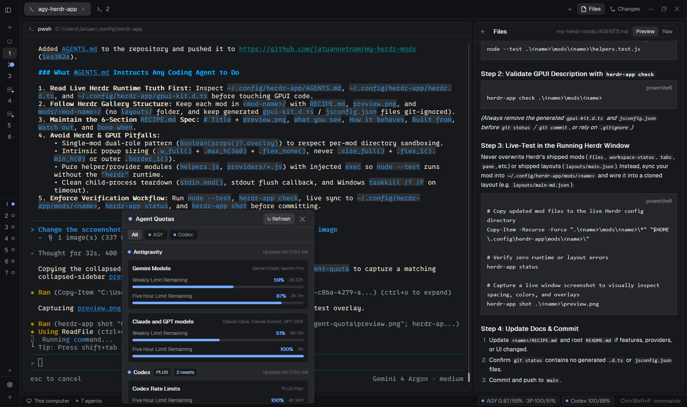

# Agent Quota Hub

A dual-role status bar and popup hub mod (`mods/agent-quota`) that displays live remaining quota pills for **Antigravity (`agy`)** and **OpenAI Codex (`codex`)** in the bottom status bar and opens a tabbed multi-provider Quota Hub popup (`All | AGY | Codex`) with GPU progress bars, reset countdowns, and account badges.

This file is the brief: enough to build Agent Quota Hub from an empty folder. The files next to it are one build of it. If they don't work on your Herdr, or you want it different, build it again from here.

## What you see

- **Status bar (`28px` high, `14px` horizontal padding, `t.chrome` background, `1px` top border in `t.border`, `11.8px` text in `t.muted`):**
  - Left: active machine icon (`server.svg` or `monitor.svg`, `13px`) + machine name (`"This computer"` or remote host), git branch icon (`branch.svg`) + branch name, and agent count (`6px` dot + `"N agents"`, plus `"· M needs you"` in `t.blocked` when any agent is blocked).
  - Right: a horizontal strip of compact provider pills (`20px` high, `7px` horizontal padding, `6px` gap, `5px` radius, `t.surface` fill, `1px` `t.border` border) followed by the palette shortcut hint (`Ctrl+Shift+P  commands` in `t.dim`):
    - Antigravity pill: `6px` status dot + `AGY G:93/61% · 3P:100/51%` (showing 5-hour / weekly remaining percentages for Gemini and Claude/GPT groups, collapsing `100/100%` to `100%`).
    - Codex pill: `6px` status dot + `Codex 100/88%` (showing 5-hour / weekly remaining percentages).
- **Quota Hub popup (`kind: "popup"`, `430px` wide, up to `460px` intrinsic height, `t.popover` background, `t.foreground` text):**
  - **Header (`38px` high, `14px` horizontal padding, `1px` bottom border):** `8px` accent dot (`t.accent`), `"Agent Quotas"` (`13px` semibold), `"↻ Refresh"` button (`11px`, `5px` radius, `t.selected`), and `"✕"` close button (`22×22px`).
  - **Tab bar (`34px` high, `12px` horizontal padding, `6px` gap, `1px` bottom border):** segmented pills for `All`, `● AGY`, and `● Codex` (`22px` high, `9px` horizontal padding, `5px` radius, `11px` text, `t.selected` when active).
  - **Scrollable body (`max_h: 360px`, `12px` padding, `12px` gap):**
    - Per-provider section header: `7px` status dot, provider name (`"Antigravity"`, `"Codex"`, `12px` semibold), metadata badges (`PLUS`, `2 resets`, `LIMIT REACHED` in `10px` semibold bordered pills), and right-aligned `"Updated HH:MM"` timestamp (`10px`, `t.dim`).
    - Quota group cards (`10px` padding, `8px` radius, `t.surface` fill, `1px` `t.border`): group title + right-aligned model/plan subtitle (`10px`, `t.dim`), followed by each rate-limit window (`Five Hour Limit Remaining`, `Weekly Limit Remaining`) with remaining `%` (`11px` semibold, colored by level), reset countdown (`· 4h 58m`, `10px`, `t.dim`), and a `6px`-high proportional GPU progress bar (`h_flex` with `.flex_grow(filled)` and `.flex_grow(100 - filled)`).

## How it behaves

- **Remaining-quota color semantics everywhere:**
  - `> 50%` remaining (`"good"`): green (`t.done`).
  - `20% – 50%` remaining (`"warn"`): amber (`t.working`).
  - `< 20%` remaining or spend/usage limit reached (`"low"`): red (`t.blocked`).
  - While loading with no prior snapshot: amber dot + `"AGY …"` / `"Codex …"`. On error with no prior snapshot: red dot + `"AGY –"` / `"Codex –"`.
- **Parallel zero-token polling:**
  - Status bar instance polls all registered providers concurrently (`Promise.allSettled`) on startup and every `180,000ms` (3 minutes), storing normalized state in `shared("agent.quotas")`.
  - If a refresh fails after a valid snapshot was already fetched, `mergeProviderResult` keeps the previous `snapshot` on screen while recording `status: "error"` and showing a subtle warning line in the popup.
- **Targeted popup navigation:**
  - Clicking the `AGY` status bar pill opens the popup directly on the `AGY` tab (`props: { tab: "agy" }`); clicking the `Codex` pill opens it on the `Codex` tab (`props: { tab: "codex" }`).
  - Clicking `All`, `AGY`, or `Codex` inside the popup switches tabs immediately. Clicking `↻ Refresh` refreshes all providers on `All` or only the selected provider on a provider tab. Pressing `Escape` or clicking `✕` closes the popup.

## Built from

- **One self-opening mod**, `mods/agent-quota/`, with `mod.json` (`{ "place": "none", "overlay": { "kind": "popup", "width": 430, "height": 460 } }`), `main.js`, `helpers.js`, `helpers.test.js`, and `providers/` (`index.js`, `agy.js`, `codex.js`).
- **Dual-role rendering in `main.js`:** Checks `Boolean(props()?.overlay)`. When false, renders the status bar block (`"id": "status"` in the layout); when true, renders the popup overlay. Putting both roles in one mod avoids cross-mod relative imports rejected by Herdr's per-mod directory sandbox.
- **Provider 1 — Antigravity (`providers/agy.js`):**
  - Runs `exec("agy", ["-p", "/usage", "--output-format", "json"], { timeout: 15000 })` (`0` tokens, `num_turns: 0`).
  - Parses `command.data.groups` (`remaining_fraction` `0..1` and ISO `reset_time`).
- **Provider 2 — OpenAI Codex (`providers/codex.js`):**
  - Runs `exec("node", ["-e", CODEX_RPC_SCRIPT], { timeout: 15000 })`, which spawns `codex app-server` (`cmd.exe /d /s /c "codex app-server"` on Windows with `windowsHide: true`, `sh -lc "codex app-server"` on POSIX), sends JSON-RPC `initialize` (`id: 1`) followed by `initialized` and `account/rateLimits/read` (`id: 2`), flushes the `id: 2` JSON response to stdout, closes stdin, and terminates the child (using `taskkill /PID <pid> /T /F` on Windows if the 12-second safety timeout fires).
  - Converts Codex's `usedPercent` (`0..100` used) to **remaining** fraction `(100 - usedPercent) / 100`, converts Unix-second `resetsAt` to ISO 8601 UTC strings, sorts the `"codex"` limit first, and extracts `planType` (`PLUS`, `PRO`), `rateLimitResetCredits.availableCount` (`2 resets`), credit balances, and `LIMIT REACHED` badges.
- **Adding future harnesses (Claude Code, OpenCode, etc.):** Create `mods/agent-quota/providers/<id>.js` exporting `{ id, name, shortLabel, fetchRaw, parse }` and append it to `PROVIDERS` in `providers/index.js`.

## Watch out

- Never use `.size_full()` on the popup root or `.flex_1().min_h(0)` on the popup body inside a `kind: "popup"` overlay—Herdr sizes popups to their content's intrinsic height, so flex-1 children collapse to `0px`. Use `.w_full()` on the root, `.max_h(360).overflow_y_scrollbar()` on the body, and `.flex_none()` on every header item and card.
- Herdr draws the outer border and shadow on `kind: "popup"` overlays; do not put `.border_1()` on the popup root or it will draw a double border.
- Codex reports `usedPercent` (used), whereas Antigravity reports `remaining_fraction` (remaining). Always normalize to remaining quota so `100%` means full quota available across every provider.
- Disclose to the user before installing that this mod runs `agy -p "/usage" --output-format json` and `node -e ...` (`codex app-server`) every 3 minutes via `exec()`.

## Done when

- `node --test mods/agent-quota/helpers.test.js` passes all 6 unit tests (remaining clamping, `AGY` pill formatting, `Codex` `usedPercent` → remaining conversion, epoch-second `resetsAt` conversion, multi-limit key ordering, `spendControlReached` level zeroing, and transient error snapshot preservation).
- `herdr-app check mods/agent-quota` exits `0`.
- Replacing `"mod": "workspace-status"` with `"mod": "agent-quota"` in the layout's `"id": "status"` block renders both `AGY` and `Codex` pills on the status bar with zero errors in `herdr-app status`.
- Clicking either status bar pill opens the popup on that provider's tab with accurate progress bars, badges, and countdowns, and `Escape` or `✕` closes it cleanly.
