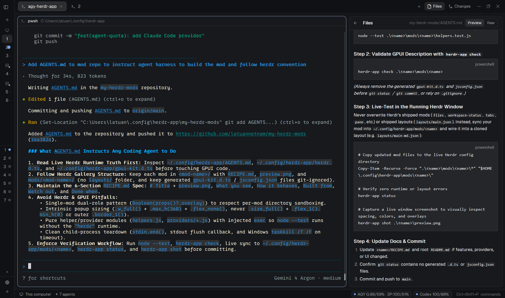

# Markdown Files

A drop-in replacement for Herdr's right-hand Files panel that renders `.md`, `.markdown`, and `.mdx` documents natively using GPUI's `TextView.markdown` while preserving a segmented `Preview | Raw` toggle, live file-watcher updates, and clickable relative or external links.

This file is the brief: enough to build Markdown Files from an empty folder. The files next to it are one build of it. If they don't work on your Herdr, or you want it different, build it again from here.

## What you see

- A rounded card (`radius: 10`, `1px` `border` in `t.border`, `t.background` fill, `13px` text in `t.foreground`) filling the right-hand `files` stack child (`368px` default width, resizable from `280px` to `900px`).
- **Header bar (`42px` high, `14px` horizontal padding, `1px` bottom border):**
  - When viewing a file: a `20px` `←` back button on the left (`t.muted`), `"Files"` in semibold, the relative file path truncated on the right (`12px`, `t.dim`), and—for Markdown files—a segmented `Preview | Raw` pill switch (`2px` padding, `6px` radius, `t.surface` frame, active pill in `t.selected` + `t.foreground`, inactive in `t.muted`, `11px` text).
  - When browsing the tree: `"Files"` on the left and the root folder's basename on the right (`12px`, `t.dim`).
- **File tree (`6px` padding, vertical scrollbar):**
  - `28px` rows indented by `8 + depth * 18` px, `7px` rounded hover highlight (`t.hover`), `12px` chevron icon for folders (`t.dim`), `14px` folder/file icon (`t.muted`), truncated filename, and right-aligned `11px` git status badge (`A` in `t.ansi2`, `D`/`U` in `t.ansi1`, `M` in `t.blocked`).
- **File viewer (replaces the tree when a file is selected):**
  - For `.md`, `.markdown`, and `.mdx` files in `Preview` mode: a scrollable container (`14px` padding) holding `TextView.markdown` with selectable text, native headings, code blocks, tables, lists, and clickable links.
  - For `Raw` mode or any non-Markdown file: a read-only syntax-highlighted `Editor` (`12px` monospace font, ANSI theme syntax tokens).

## How it behaves

- Follows the focused terminal pane's live working directory (`panes()[i].cwd`), falling back to the active space's folder (`spaces()[i].folder`), including remote SSH machines (`on: space.machine`).
- Remembers expanded folders, the open file, and the selected `Preview | Raw` mode per `(space, machine, cwd)` key in memory when switching spaces or tabs.
- Watches the local root directory with `watchFolder(root)` and polls every `10,000ms`. When an open file changes on disk, `reloadOpenFile` re-reads it in place without resetting scroll or view mode unless the content actually changed.
- Clicking a `.md` / `.markdown` / `.mdx` file opens it in `Preview` mode by default; switching to `Raw` shows the read-only source editor, and switching back to `Preview` restores rendered Markdown.
- Clicking a link inside rendered Markdown classifies the target:
  - `#anchor` or empty links are ignored safely.
  - `http://`, `https://`, and `mailto:` links open in the system browser (`rundll32 url.dll,FileProtocolHandler` on Windows, `open` on macOS, `xdg-open` on Linux).
  - Relative workspace links resolve against the current file's directory, normalize `.` and `..` (including percent-encoded slashes), reject paths that escape above the workspace root, and either open the target file (expanding its parent folders) or expand and reveal the target directory in the tree.
- Agent status does not alter this panel; it strictly reads the filesystem and git status without writing to files or terminals.

## Built from

- **One mod**, `mods/my-files/`, with `main.js`, `helpers.js`, `helpers.test.js`, `mod.json` (`{ "place": "none" }`), and four `1.5px`-stroke SVG icons (`folder.svg`, `file.svg`, `chevron-right.svg`, `chevron-down.svg`).
- **Layout integration:** Clones the person's layout (or updates the `"id": "files"` block inside `panel-body`) so `"content": { "mod": "my-files" }` replaces `"mod": "files"`.
- **GPUI components:** `View`, `div`, `svg` from `"gpui-kit"`, and `v_flex`, `h_flex`, `Editor`, `EditorState`, `TextView` (`TextView.markdown(id, markdown).selectable(true).on_link_click(...)`) from `"gpui-base"`.
- **Herdr APIs:** `spaces()`, `panes()`, `focused()`, `exec()`, `readTextFile()`, `watchFolder()`, `theme()`, `settings()`, and `window()`.
- **External commands:**
  - Directory listing: `powershell -NoProfile -Command ... Get-ChildItem ... ConvertTo-Json` on Windows (handling spaces, apostrophes, Unicode filenames, and symlink/reparse targets) or `sh -c` null-delimited globbing on macOS/Linux/remote POSIX hosts.
  - Git status markers: `git rev-parse --show-toplevel` and `git --no-optional-locks -c core.fsmonitor=false status --porcelain=v1 -z --no-renames --untracked-files=all`.
  - External link launching: `rundll32`, `open`, or `xdg-open`.

## Watch out

- Never edit Herdr's shipped `mods/files` or `layouts/main.json`; clone the layout first (`herdr-app do layout.clone '{"name":"main","as":"main-md"}'`) and point the cloned layout's `files` block to `"my-files"`.
- Binary files (containing null bytes `\0` in the first `8,192` characters) must be rejected before creating `EditorState` or `TextView.markdown`, showing `"Binary file · no text preview"`.
- Large files must be capped at `400,000` characters (`boundFileText`) with a truncation notice so GPUI text layout never stalls the UI thread.
- Directory listings are bounded to `500` entries per folder and `5,000` total entries (`depth <= 40`).
- When probing whether a relative link points to a folder (`probeFolderTarget`), if loading that folder fails or yields no entries, roll back any parent folders added to `this.folders` so broken links never leave ghost entries in the tree.
- Disclose to the user before installing that this mod runs `powershell`/`sh` to list directories, `git` to read file status, `readTextFile` to preview files, and `rundll32`/`open`/`xdg-open` when clicking external URLs.

## Done when

- `node --test mods/my-files/helpers.test.js` passes all 5 unit tests (extension detection, binary/400k bounding, link classification & percent-encoded traversal blocking, and folder probe rollback).
- `herdr-app check mods/my-files` exits `0`.
- Opening the Files panel and clicking a `.md` file renders formatted Markdown in `Preview` mode and switches cleanly to syntax-highlighted source in `Raw` mode.
- Clicking a relative file or directory link inside a Markdown preview navigates to that file or expands that folder in the tree; paths escaping `..` above the workspace root do nothing.
- Modifying the open `.md` file on disk updates the preview automatically without manual refresh.
